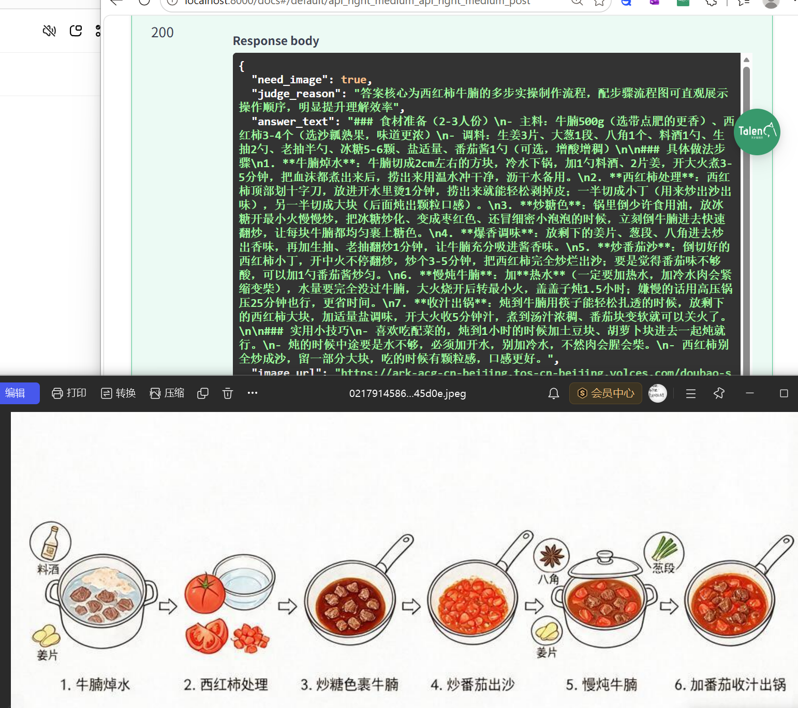
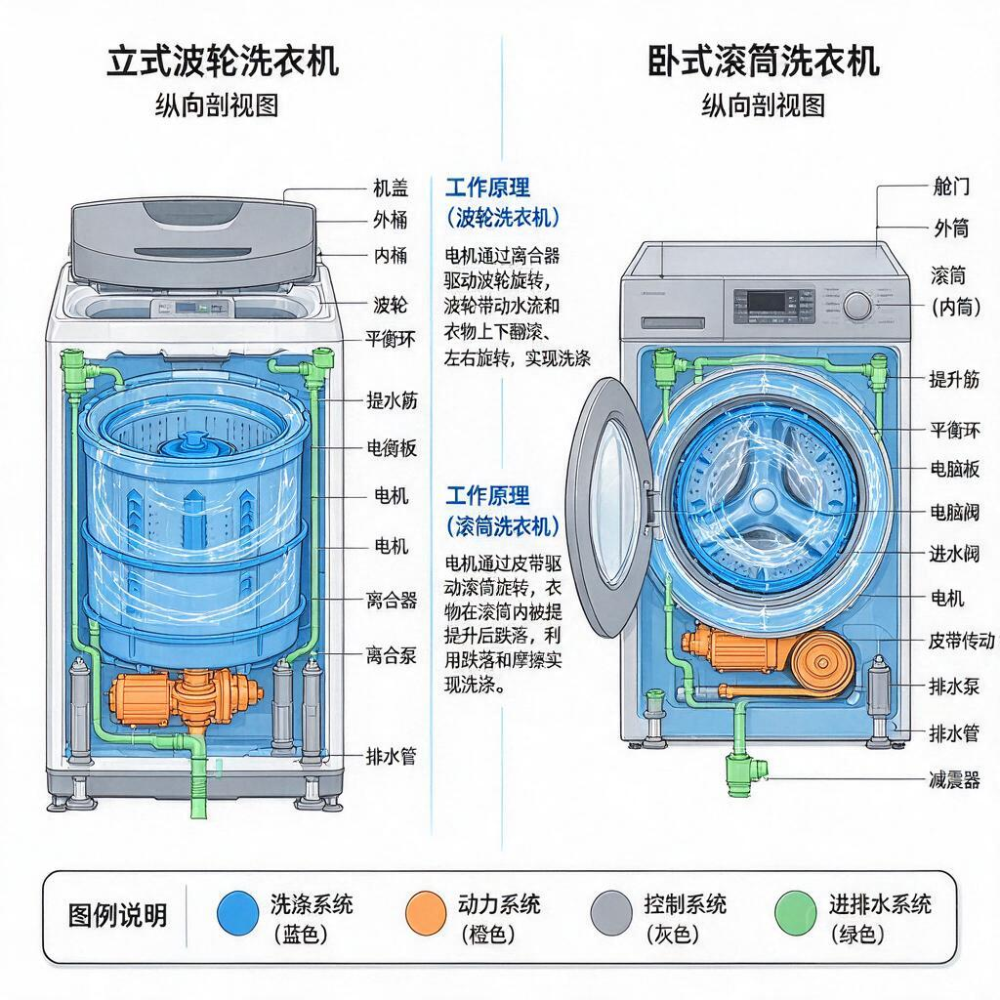
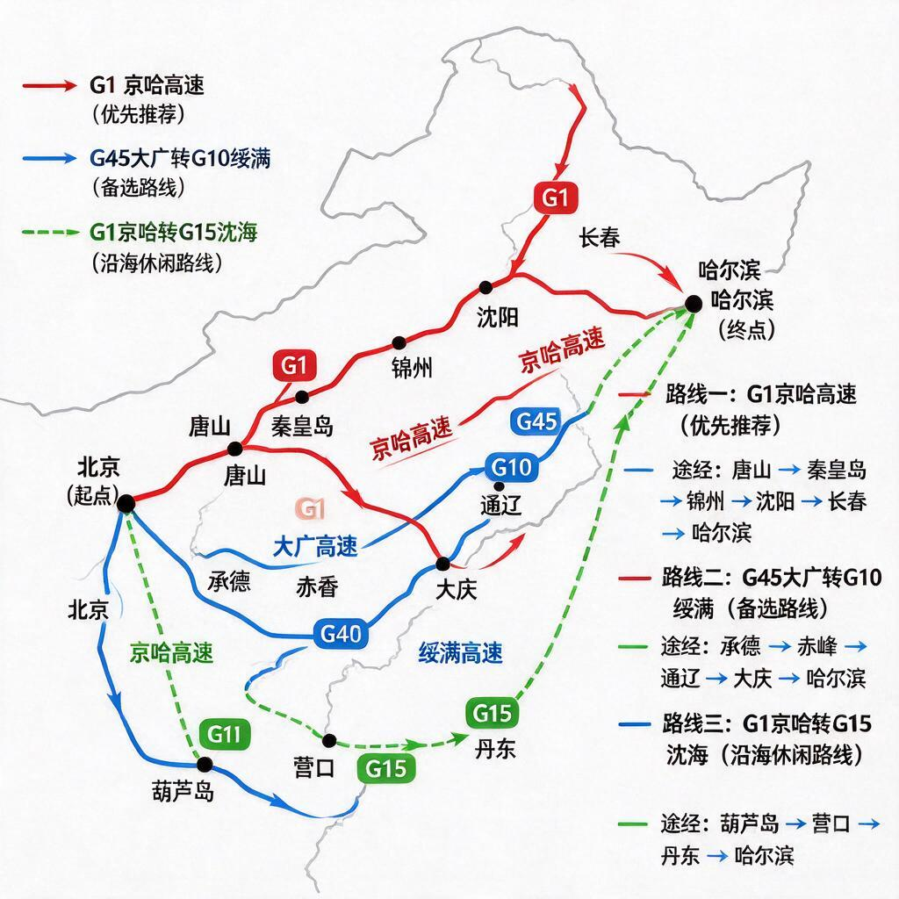

# 图字择优 · 智能回答 Skill

> 让大模型自主判断该用文字还是配图回答的 AI Skill

---

## 项目简介

现在的大模型回答形式太单一——不管什么问题都纯文字输出。但有些问题，一张图比一千字管用。

本项目实现了一套**自动判断机制**：用户不用显式说"画个图"，模型自己判断这个问题该用文字还是配图，然后自动输出最佳形式。

**核心理念：字是默认，图是例外。**

---

## 解决什么问题？

| 问题类型 | 纯文字的痛点 | 配图的优势 |
|---------|-------------|-----------|
| 「西红柿牛腩怎么做？」 | 读半天还是不知道先放啥 | 一张步骤流程图，跟着做就行 |
| 「15平出租屋怎么布局？」 | 想象不出来摆哪 | 一张平面图，秒懂 |
| 「平板支撑标准姿势？」 | 文字描述动作很费劲 | 一张动作示意图，一眼看懂 |
| 「为什么不能裸辞？」 | - | 图没法表达否定逻辑，必须用字 |

用户不会主动说"帮我画个图"，但如果模型主动配图，体验会好很多。

---

## 核心设计思路

放弃两个极端：

| 极端路线 | 问题 |
|---------|------|
| 用户让画才画（约束式） | 用户不会主动说"画图"，形同虚设 |
| 什么问题都画（放权式） | 模型为了显得智能，到处画图，大部分是废图 |

**走中间路线：给模型一套判断框架**

三层判断逻辑：
1. **字优先**：否定命题、抽象逻辑 → 纯文字（图表达不了否定）
2. **图场景**：流程步骤、空间布局、多维对比、量的变化 → 配图
3. **默认字**：都不命中 → 纯文字

---

## 效果展示

### ✅ 正确出图的场景

#### 1. 菜谱步骤类
**问题：西红柿牛腩怎么做？**



#### 2. 空间布局类
**问题：出租屋15平怎么放床和衣柜？**


#### 3. 结构类
**问题：洗衣机的内部结构是什么样的？**



#### 4. 路径规划类
**问题：从北京到哈尔滨自驾怎么走最合理？**



---

### ✅ 正确不出图的场景

| 问题 | 为什么用字 |
|------|-----------|
| 为什么不建议年轻人裸辞？ | 否定命题，图表达不了"为什么不" |
| 什么是递归？请用大白话解释 | 抽象概念定义，图反而模糊边界 |
| 怎么理解"沉没成本"这个概念？ | 概念辨析，纯文字更准确 |
| 推荐三部适合周末看的电影 | 信息罗列，文字列表就够了 |

---

## 测试结果

在 24 条真实用户问题测试集上的表现：

| 指标 | 数值 | 目标 |
|------|------|------|
| **总准确率** | **90.9%** | - |
| 召回率（该出图的判对率） | 80.0% | ≥ 85% |
| 精确率（判出图的正确率） | 100.0% | ≥ 80% |
| **否定场景拦截率** | **100.0%** | ≥ 95% |

### 分组表现

| 分组 | 准确率 |
|------|--------|
| 图场景（流程/空间/对比） | 85.7% |
| 字场景（否定/抽象/常识） | 100.0% |
| 边界场景 | 87.5% |

> 详细测试报告见 `v1结果/before_report.md`

---

## 技术架构

```
用户提问
    ↓
┌─────────────────┐
│  判断层（大模型） │  ← 判断该用图还是字
│  三层决策框架     │
└─────────┬───────┘
          │
    ┌─────┴─────┐
    ↓           ↓
 need_image    need_text
    │           │
    ↓           ↓
生成绘图Prompt  直接文字回答
    │
    ↓
调用生图模型
    │
    ↓
返回 文字 + 图片
```

---

## 技术栈

- **后端框架**：Python · FastAPI
- **文本模型**：豆包大模型（判断 + 回答）
- **生图模型**：Seedream 5.0 Flash
- **平台接入**：扣子（Coze）自定义插件
- **部署**：cpolar 内网穿透（本地接口暴露公网）

---

## 项目结构

```
├── README.md                    # 项目说明（本文件）
├── SKILL.md                     # Skill 主定义（给大模型看的）
├── scripts/
│   ├── figure_or_text.py        # v1 后端服务
│   └── figure_or_text_v2.py     # v2 版本（流式 + 六分类）
├── references/
│   ├── decision_prompt.md       # 判断框架 Prompt
│   └── test_cases.md            # 测试用例集（24条）
├── assets/
│   └── demo.html                # 前端演示页面
├── v1结果/                      # 测试结果 + 生成的图片
│   ├── before_report.md         # 基线测试报告
│   └── *.jpg/png                # 实际生成的效果图
└── requirements.txt             # Python 依赖
```

---

## 快速开始

```bash
# 1. 安装依赖
pip install -r requirements.txt

# 2. 配置环境变量
cp .env.example .env
# 编辑 .env，填入你的火山方舟 API Key

# 3. 启动服务
python scripts/figure_or_text.py

# 4. 打开接口文档
# 浏览器访问 http://localhost:8000/docs
```

---

## 项目成果

- ✅ 完整跑通「问题判断 → 文字回答 → 按需生图」全链路
- ✅ 判断准确率 90.9%，否定场景拦截率 100%
- ✅ 已接入扣子平台，实现大模型自动调用插件
- ✅ 生成 9 张真实场景的示意图，效果可用

---

## 后续规划

1. 优化召回率（目前 80%，目标 85%+）
2. v2 版本：流式返回 + 更细的形态分类
3. 部署到云服务器，长期可用
4. 扩展垂直场景（教育、职场、生活）
